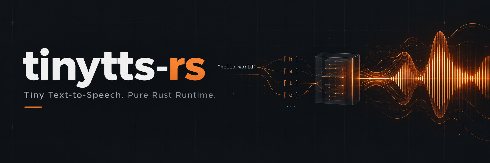

# tinytts-rs



A from-scratch ONNX inference runtime in Rust, specialized for one model: a
7.88M-parameter int8 text-to-speech network.

**Zero dependencies.** No `ort`, no `tract`, no ONNX Runtime, no Python at run
time. The protobuf reader, graph loader, tensor type and all 56 op kernels are
implemented in this repository. `runtime/Cargo.toml` has an empty
`[dependencies]` section.

## What it is and is not

It is a **single-model runtime**, not a general ONNX engine. It implements the
56 op types this graph uses, with the shapes and dtypes this graph uses. It will
reject anything else rather than silently produce wrong numbers.

ONNX Runtime synthesizes 3-4x faster; this runtime loads in 8 ms instead of 610,
runs in 79 MB instead of 230, and needs nothing but a Rust compiler.

## Two files. That's the whole system.

| file | size | what |
|---|---:|---|
| `tinytts` binary | **542 KB** | the runtime, statically linked, zero dependencies |
| `paradee_int8.onnx` | **8.1 MB** | the model, downloaded from Hugging Face |

**8.6 MB total** - smaller than one MP3. No Python, no ONNX Runtime, no DLLs,
no config. Copy both files to any x86-64 machine and it speaks.

No Rust? Grab the prebuilt Windows binary from
[Releases](https://github.com/Banshal-Yadav/tinytts-rs/releases) (267 KB zip).

## Hear it

Both files were generated by this runtime, not the Python baseline. Click play:

https://github.com/user-attachments/assets/c6d593af-9802-4b76-a136-8b90355c8298

"Hello, this is tinytts, a small speech synthesis runtime written in Rust."
72 tokens, 5.0 s of audio, synthesized in **0.37 s** (13.7x realtime).

https://github.com/user-attachments/assets/689864b8-f097-4b67-ba15-5f1d53a76d49

A 512-token paragraph from `text/long_text.txt`, default chunking.
32.1 s of audio, synthesized in **2.2 s** (14.6x realtime).

Both on one laptop core, single thread, after an **8 ms** load.

Regenerate with `python scripts/gen_audio.py`.

## Input is phoneme ids, not text

The model takes **phoneme token ids**, not characters or words. There is no
tokenizer in this repository and no text front end: grapheme-to-phoneme is a
separate problem, and the model was trained on one specific phonemizer's output.

The ids must follow the [misaki](https://github.com/hexgrad/misaki) convention,
because that is what the model saw in training. `vocab.txt` lists the 114 IPA
phonemes and their ids. The sequence is wrapped in `0` (BOS/EOS) at both ends.

To get ids from text you need a phonemizer. The upstream Python package does
this:

```python
from paradee import Paradee
tts = Paradee(version="1.1", quantized=True, model_path="paradee_int8.onnx")
ids = [0] + [tts.vocab[c] for c in tts.phonemize("Hello there.")] + [0]
```

`scripts/gen_audio.py` shows the same thing end to end. Feeding raw characters
or eSpeak phonemes produces wrong audio, not an error.

## Measured performance

Machine: AMD Ryzen 7 7735HS (Zen 3+, 8C/16T), 16 GB DDR5-5600, Windows 11,
power scheme "Best performance", background applications closed. Single thread
unless stated. 52-token input, 3.425 s of audio at 24 kHz.

| | ONNX Runtime 1 thread | ONNX Runtime 4 threads | this runtime |
|---|---:|---:|---:|
| load | 610.5 ms | - | **7.9 ms** |
| synth (p50) | 93.0 ms | 54.9 ms | 371.4 ms |
| real-time factor | 36.8x | 62.4x | 9.2x |
| RSS while loaded | 82 MB | 82 MB | **24 MB** |
| peak RSS | 230 MB | 230 MB | **79 MB** |

(The 79 MB peak is from the interleaved A/B benchmark session; the
fresh-process table below measures 42.7 MB for the same input. Both are
reported because they answer different questions: head-to-head ratio vs
absolute floor.)

Load is **77x faster** and peak memory is **2.9x smaller**. Synthesis is
**4.0x slower** than ORT on one thread.

Methodology: `scripts/benchmark.py` for the head-to-head, `scripts/rss_fresh.py`
for memory (one fresh process per measurement, so the RSS high-water mark is not
contaminated by an earlier run), `scripts/bench_stats.py` for p50/p95 over 20
runs after 3 warmups. Absolute milliseconds on this laptop drift by 20%+ between
sessions, so speed comparisons use an interleaved A/B benchmark
(`scripts/ab_bench.py`) that runs both binaries alternately in one session and
reports only the ratio.

### Memory across input lengths

Fresh process per measurement, one load and one run each.

| input | tokens | audio | loaded RSS | peak LIVE | peak RSS | synth p50 |
|---|---:|---:|---:|---:|---:|---:|
| short | 13 | 0.93 s | 15.6 MB | 13.3 MB | 30.5 MB | 112.9 ms |
| mid | 52 | 3.43 s | 15.8 MB | 25.3 MB | 42.7 MB | 249.0 ms |
| long | 512 | 30.30 s | 15.7 MB | 148.5 MB | 166.1 MB | 1920.9 ms |

Loaded RSS is flat at ~15.7 MB regardless of input length: that is the model
weights plus the runtime. Peak scales with the input because the vocoder's
intermediates do.

For long inputs the CLI chunks at sentence boundaries, which caps peak RSS at
the single-chunk level and gets the first audio out much sooner:

| mode | chunks | peak RSS | synth | time to first audio | audio |
|---|---:|---:|---:|---:|---:|
| `--no-chunk` | 1 | 205.8 MB | 2160.4 ms | 2160.4 ms | 30.30 s |
| default (auto) | 7 | 65.0 MB | 2285.5 ms | 369.9 ms | 32.12 s |
| `--chunk 60` | 11 | 53.2 MB | 2524.9 ms | 311.4 ms | 33.38 s |

Chunking costs total synth time and lengthens the audio slightly (each chunk is
a separate utterance, so the duration predictor gives it its own rhythm), which
is why it is opt-in above 100 tokens rather than always on.

### Improvement over the naive baseline

The first working version of this runtime, before any optimization, ran the same
52-token input in **6617 ms** with a **417 MB** peak RSS. It is now 371 ms and
79 MB: **17.8x faster** and **5.3x smaller**. The wins, in order of size:

| change | effect |
|---|---|
| the 6 `/head` convs are windowed DFTs, not learned kernels -> FFT | 6617 -> 3835 ms |
| `/head/ConvTranspose` -> GEMM + overlap-add | 3835 -> 2725 ms |
| AVX2+FMA SGEMM + im2col conv | 2725 -> 1092 ms |
| elementwise broadcast fast paths | 1092 -> 721 ms |
| liveness-based buffer freeing | peak RSS 417 -> 126 MB |
| fuse the `/head` sine-excitation chain | 676 -> 567 ms, RSS 126 -> 79 MB |
| lazy dequantization, refcounted tensor data | loaded RSS 31.8 -> 15.4 MB |

`docs/PERFORMANCE_NOTES.md` has the full record, including what was tried and
did not help.

## Getting the model

The weights are **not** in this repository. Download them from Hugging Face:

```bash
curl -L -o paradee_int8.onnx \
  https://huggingface.co/sahilmahendrakar/Paradee-8M-v1.1/resolve/main/onnx/paradee_int8.onnx
```

See `MODEL.md` for the source, license and attribution.

## Build and run

```bash
cd runtime
cargo build --release
./target/release/tinytts ../paradee_int8.onnx 0 16 43 44 45 16 4 0
# Windows (PowerShell):
.\target\release\tinytts.exe ..\paradee_int8.onnx 0 16 43 44 45 16 4 0
```

The trailing numbers are phoneme token ids (see above). The model takes
`input_ids [1, tokens]` (int64) and `speed [1]` (float32), and returns
`waveform [1, samples]` at 24 kHz. Token 0 is BOS/EOS, 4 is `.`, 3 is `,`,
16 is a space.

Output goes to `out.wav`. Timing and memory go to stderr.

### Flags

| flag | effect |
|---|---|
| `--profile` | per-op-type totals and the top 15 nodes by time |
| `--chunk N` | split at sentence boundaries, at most N tokens per chunk |
| `--no-chunk` | disable chunking (default above 100 tokens) |
| `--crossfade MS` | crossfade between chunks (default 10) |
| `--stream` | write each chunk to `chunk_NNN.wav` as soon as it is ready |
| `--rng-seed N` | fix the noise seed, so repeated runs are byte-identical |
| `--shapes` | dump every node's input/output shapes and exit |

### Environment variables

| variable | default | effect |
|---|---|---|
| `FUSE=0` | on | disable all graph rewrites (used by the differential test) |
| `FOLD_BASIS=1` | **off** | fold the `/head` DFT-basis subgraph into initializers |
| `FUSE_SKIP=<name>` | - | disable one rewrite pass, to isolate its cost |

`FOLD_BASIS` is off by default because it is a load/synth trade, not a speedup:
it costs 3.2 MB of loaded RSS and 1.8 MB of peak RSS to save 15 ms of synth,
which a one-shot process pays back in load time. Turn it on for a long-lived
process that loads once and synthesizes many times.

## Supported ops

56 op types, all implemented by hand:

`Add` `And` `Cast` `Ceil` `Concat` `Constant` `ConstantOfShape` `Conv`
`ConvTranspose` `Cos` `CumSum` `DequantizeLinear` `Div` `Equal` `Erf` `Exp`
`Expand` `Floor` `Gather` `GatherElements` `Greater` `GreaterOrEqual` `Identity`
`InstanceNormalization` `LayerNormalization` `LeakyRelu` `Less` `Log` `LSTM`
`MatMul` `Max` `Min` `Mod` `Mul` `Neg` `Not` `Or` `Pad` `Pow` `Range`
`RandomNormalLike` `Reciprocal` `ReduceSum` `Reshape` `Resize` `Shape` `Sin`
`Slice` `Softmax` `Split` `Sqrt` `Squeeze` `Sub` `Tanh` `Transpose` `Unsqueeze`

Plus four fused ops the graph rewriter creates: `Dequant`, `ElemChain`,
`SineExcitation`, `StridedSlice`.

## Limitations

- **x86-64 only for SIMD.** The AVX2+FMA paths are compiled only on x86-64 and
  detected at run time. There is no NEON path yet: ARM builds compile and run
  on the scalar fallback, and are much slower.
- **One model.** The op set, the fusion patterns and the FFT replacement are all
  specific to this graph. It is not a general ONNX runtime.
- **Phoneme ids in, not text.** No tokenizer or grapheme-to-phoneme front end.
- **Windows memory reporting.** RSS is read through `K32GetProcessMemoryInfo`;
  on other platforms the runtime reports 0.
- **English only**, one voice, American pronunciation. The voice is baked into
  the weights; there is no style or speaker input.
- **512-token cap** per chunk (~30 s of audio). Longer input is split at
  sentence boundaries; a single sentence longer than 512 tokens is rejected.

## Why this runtime

- Loads in **8 ms**, not 610 ms (77x faster than ONNX Runtime)
- **79 MB** peak memory, not 230 MB
- **542 KB** static binary, zero dependencies, no DLLs
- **8.6 MB** total: binary + model, smaller than one MP3
- **9-14x realtime** on a single laptop core, faster than you can listen
- **17.8x faster** and **5.3x smaller** than the naive first version
- Chunked streaming: first audio in **370 ms** on a 30 s paragraph

## Tests

The correctness net is a per-node differential test against ONNX Runtime. Golden
tensors are not committed (they are ~3.4 GB for three input lengths); regenerate
them once, then the test runs with no Python and no onnxruntime:

```bash
python scripts/dump_golden.py paradee_int8.onnx golden          # 52-token
IDS="..." python scripts/dump_golden.py paradee_int8.onnx golden_short
IDS="..." python scripts/dump_golden.py paradee_int8.onnx golden_long
python scripts/gate.py                                          # all three
```

```bash
cd runtime
cargo test --release
```

See `docs/TESTING.md` for what each mode checks and the tolerances.

## Documentation

- `docs/ARCHITECTURE.md` - how the runtime is put together
- `docs/BENCHMARKS.md` - the measured tables and how to reproduce them
- `docs/TESTING.md` - the golden harness and the regression gate
- `docs/PERFORMANCE_NOTES.md` - what was tried, what helped, what did not

## Credits

The model this runtime targets is
[Paradee-8M v1.1](https://huggingface.co/sahilmahendrakar/Paradee-8M-v1.1) by
Sahil Mahendrakar, distilled from
[Kokoro-82M](https://huggingface.co/hexgrad/Kokoro-82M), which is itself derived
from [StyleTTS2](https://github.com/yl4579/StyleTTS2). See `MODEL.md`.

This runtime is an independent implementation and is not affiliated with or
endorsed by the model's author.

## License

Dual-licensed under either of

- Apache License, Version 2.0 (`LICENSE-APACHE`)
- MIT license (`LICENSE-MIT`)

at your option.

The model weights are Apache-2.0 and are not distributed here; see `MODEL.md`.
